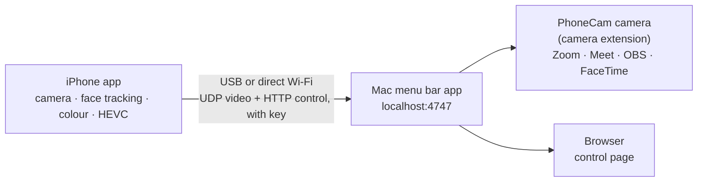

# PhoneCam

**Turn your iPhone into a great Mac webcam, and actually control it.**


Your iPhone has a much better camera than your Mac. Apple's Continuity Camera lets you use it, but you can't
change much: not where it focuses, not the exposure, not the colours.

PhoneCam fixes that. Put the phone on a mount, open the app, and a **PhoneCam** camera shows up on your Mac in
Zoom, Google Meet, Telegram, FaceTime, OBS and every other app. You tune the picture from a simple page in your
browser.

## What you get

- **Focus stays on your face**, not on the microphone in front of you. Or click anywhere on the preview to focus there.
- **No blown-out background.** Auto exposure keeps your face bright and pulls back when a white wall or window
  starts to clip. Or lock it once it's right, so the picture doesn't pump when you move.
- **Natural skin under coloured lights.** In Skin white balance, with a blue light behind you and a warm lamp in
  front, your face still looks like a face, and the background keeps its colour.
- **You stay in the middle of the frame.** The picture gently follows you, like a camera operator would, without
  jitter.
- **Always upright and level.** Mount the phone any way you like (landscape, upside down, upright); the picture turns
  itself and straightens a slightly crooked horizon.
- **Rich but natural colour.** Saturation, contrast and per-colour controls (tame a loud blue wall, keep skin as it is).
- **Smooth and sharp.** Shot in 4K and 10-bit, sent as 1080p at 30 fps with hardware video compression.
- **Private.** The phone talks only to your Mac, over the USB cable or a direct Wi‑Fi link between the two devices
  (like AirDrop). It never goes through your router, and nothing else on your network can watch it.

## Quick start

You need an iPhone (iOS 17+), a Mac (macOS 13+) with Xcode, and a free Apple developer account.

1. **Set up the project**

   ```sh
   brew install xcodegen
   cp Local.xcconfig.example Local.xcconfig   # fill in your Team ID, a bundle id and a random key
   xcodegen generate
   ```

2. **Install the iPhone app.** Open `PhoneCam.xcodeproj`, choose the `PhoneCam` scheme and your iPhone, press Run.
   On the phone, turn on Developer Mode (Settings → Privacy & Security) and allow camera and local network access.

3. **Install the Mac app**

   ```sh
   xcodebuild -project PhoneCam.xcodeproj -scheme PhoneCamMac -destination 'platform=macOS' \
     -allowProvisioningUpdates -allowProvisioningDeviceRegistration build
   ditto build/Build/Products/Debug/PhoneCam.app /Applications/PhoneCam.app
   open /Applications/PhoneCam.app
   ```

   Then allow the camera once: System Settings → General → Login Items & Extensions → Camera Extensions →
   turn on **PhoneCam Camera**.

4. **Use it.** Keep the PhoneCam app open on the iPhone. On the Mac, pick **PhoneCam** as the camera in your call
   app, and open `http://localhost:4747` to adjust the picture.

## Tips

- **Use the USB cable when you can.** It's the most reliable link. Without it, PhoneCam uses direct Wi‑Fi
  automatically, so keep Wi‑Fi on on both devices.
- **Light matters most.** A soft light in front of your face does more for the picture than any setting.
- **Keep the app in front on the iPhone.** iOS stops the camera when the app is in the background. The screen stays
  on; the **Dim screen** button keeps the phone cool.
- **Stop the camera** from the PhoneCam menu bar icon when you don't need it: apps see "no signal" and the iPhone
  camera sleeps.
- **Start at login:** turn it on in the PhoneCam menu bar icon so everything is ready after a restart.
- **Something looks off?** The **Reset** button on the control page brings back the defaults.

## The control page

Open `http://localhost:4747` on the Mac.

| Section | What it does |
|---|---|
| **Lens** | Ultra-wide, wide, tele or front camera; auto-frame on or off; how tight the framing is; horizon levelling |
| **Focus** | Follow your face, auto, or lock; manual distance |
| **Exposure** | Auto (default), Lock or Manual (ISO and shutter) |
| **White balance** | Auto (default), Skin or Lock; how warm the skin should look |
| **Color** | Warmth and tint, saturation, contrast, black level, and separate strength for reds, greens and blues; Reset |
| **Video** | 4K or 1080p capture (1080p keeps the iPhone cooler), 30 or 60 fps, quality, rotation |

The preview on the page is off by default, since your apps already show the picture. Turn it on to click-to-focus.

---

## For developers

### How it works



All picture processing happens on the iPhone. It encodes 1920×1080 HEVC in hardware and sends it over UDP (a lost
packet costs a frame or two instead of a stall). The Mac app receives it, serves it to the camera extension on
localhost, and relays the control page. The extension only decodes frames and hands them to apps, so it rarely needs
updating.

| File | Role |
|---|---|
| `PhoneCam/Camera.swift` | Capture and camera controls, face and body tracking, skin hue correction, auto-frame, orientation and levelling, colour grading, dithering |
| `PhoneCam/Encoder.swift` | Hardware HEVC encoder: real time, keyframes on demand, adaptive bitrate |
| `PhoneCam/UDPStreamer.swift` | Video over UDP: paced packets, keyframe and loss requests from the Mac |
| `PhoneCam/Server.swift` | HTTP server: key check, Bonjour, control API, preview and fallback streams |
| `PhoneCam/Page.swift` | The control page |
| `mac/PhoneCamMac/` | Menu bar app: finds the phone (cable or direct Wi‑Fi only), receives UDP video, relays requests with the key, installs the camera extension |
| `mac/CameraExtension/` | CoreMediaIO camera extension: hardware HEVC decoding, "no signal" card |
| `scripts/hooks/pre-push` | Blocks pushes that would publish private data (`git config core.hooksPath scripts/hooks`) |

### Endpoints (through `http://localhost:4747`)

| Path | What |
|---|---|
| `/` | Control page |
| `/state`, `/set?key=value` | JSON API used by the page |
| `/hevc` | Camera stream (used by the camera extension) |
| `/video?preview=1` | Light 640×360 MJPEG preview; without `preview`, full 1080p for an OBS Browser Source |
| `/obs` | Full-size video page |

### Notes

- Signing settings and the shared key live in the git-ignored `Local.xcconfig`.
- macOS starts an *updated* camera extension only after a reboot if an older build with the same bundle id was loaded.
  To update it without a reboot, give it a new bundle id suffix in `project.yml` and in `mac/PhoneCamMac/App.swift`.
