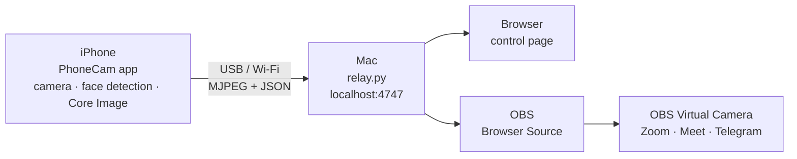

# PhoneCam

**Use your iPhone as a Mac webcam with full manual camera control.**


macOS Continuity Camera gives you the picture but almost no control over it: there are no focus, exposure or white balance
settings. PhoneCam runs the camera on the iPhone itself. It serves a control page and an MJPEG video stream over USB or
Wi‑Fi, and OBS turns the stream into a virtual camera for Zoom, Meet, Telegram and other apps.



## Features

| | |
|---|---|
| **Focus** | Follows your face (default), continuous auto or locked. Click the picture to focus on a point; manual distance slider |
| **Exposure** | Lock (default) keeps the metered brightness but moves the shutter to 1/30 s and lowers ISO for less noise. Also auto with EV, or manual ISO and shutter |
| **White balance** | **Skin** (default) keeps the face a natural tone under colored light. Also auto, lock, or a Kelvin slider |
| **Auto-frame** | A crop of the full picture calmly follows your face and keeps you centred, with a dead zone and slow easing |
| **Color** | Saturation, contrast, black level. Graded in sRGB on the GPU |
| **Video** | Ultra-wide / wide / tele / front lens, zoom, 720p / 1080p / 4K capture (default 4K), 30 / 60 fps, JPEG quality, rotation. The stream is always 1920×1080 |
| **Background blur** | Vision person segmentation (run in parallel, never slows the stream) with adjustable strength |
| **Reliability** | The control page and `/obs` reconnect by themselves after the app restarts. Settings persist |

## Requirements

- An iPhone on iOS 17+ and a Mac with Xcode
- An Apple developer account; a free one is enough to run the app on your own phone
- [XcodeGen](https://github.com/yonaskolb/XcodeGen): `brew install xcodegen`
- [OBS Studio](https://obsproject.com), to use PhoneCam as a webcam in other apps

## Build and install

```sh
cp Local.xcconfig.example Local.xcconfig   # set your DEVELOPMENT_TEAM and a bundle id
xcodegen generate
open PhoneCam.xcodeproj                    # pick your iPhone, press Run
```

1. On the iPhone, enable Developer Mode: Settings → Privacy & Security.
2. On first launch, allow camera and local network access.
3. Keep the app in the foreground, because iOS stops the camera in the background. The screen stays on while the app
   runs; the **Dim screen** button keeps the phone cool.

## Usage

The app shows its Wi‑Fi address, for example `http://192.168.1.20:4747`.

| Path | What |
|---|---|
| `/` | Control page with the live picture |
| `/obs` | The bare video, for an OBS Browser Source |
| `/video` | Raw MJPEG stream |
| `/state`, `/set?key=value` | JSON API used by the page |

> **USB is recommended.** Over a cable the phone also has a link-local address (`169.254.x.x`) with about 1 ms latency
> and enough bandwidth for full quality at 30 fps. Wi‑Fi works too, but may need a lower **Quality** setting.

### Relay for macOS 15+

If a browser shows "address unreachable", macOS has not given it Local Network permission. You can allow it in
System Settings → Privacy & Security → Local Network. Or run the relay: it finds the phone (USB first) and serves it on
localhost, which needs no permission.

```sh
python3 mac/relay.py                                   # then open http://localhost:4747
PHONECAM_HOST=My-iPhone.local python3 mac/relay.py     # if auto-discovery fails
```

### OBS

1. Sources → **+** → **Browser**. Set the URL to `http://localhost:4747/obs`, the size to 1920×1080 and a custom frame
   rate of 30.
2. Click **Start Virtual Camera**, then pick **OBS Virtual Camera** in your call app.

## How it works

| File | Role |
|---|---|
| `PhoneCam/Camera.swift` | AVFoundation capture and device controls, face detection (`AVCaptureMetadataOutput`), Skin white balance (a feedback loop on the white balance gains, using the face's average color), auto-frame crop, Core Image grading and JPEG encoding |
| `PhoneCam/Server.swift` | Small HTTP server on Network.framework: pages, MJPEG broadcast (slow clients skip frames), JSON API |
| `PhoneCam/Page.swift` | Control page and the OBS page |
| `mac/relay.py` | Localhost relay to the phone, standard library only |
| `project.yml` | XcodeGen spec. Signing settings live in the git-ignored `Local.xcconfig` |
