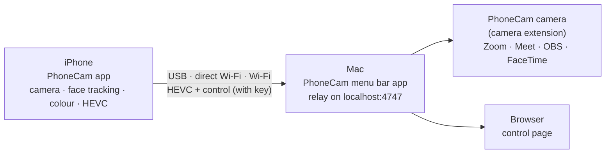

# PhoneCam

**Use your iPhone as a Mac webcam with full manual camera control.**


macOS Continuity Camera gives you the picture but almost no control over it: there are no focus, exposure or white
balance settings. PhoneCam runs the camera on the iPhone itself, does all processing there, and streams hardware HEVC
to a small Mac app. The Mac app adds a **PhoneCam** camera to macOS for Zoom, Meet, Telegram, FaceTime, OBS and other
apps, and serves a control page at `http://localhost:4747`.



## Features

| | |
|---|---|
| **Focus** | Follows your face (default), continuous auto or locked. Click the preview to focus on a point; manual distance slider |
| **Exposure** | Lock (default) keeps the metered brightness but moves the shutter to 1/30 s and lowers ISO for less noise. Also auto with EV, or manual ISO and shutter |
| **White balance** | **Skin** (default): auto white balance for the scene, plus the hue of skin tones only is turned toward natural skin, leaving the background and clothes alone. Also auto, lock, or a Kelvin slider |
| **Auto-frame** | A crop of the 4K picture calmly follows your face (or your body when the face is hidden) and keeps you centred |
| **Orientation** | Picked from gravity (0/90/180/270°); an upright phone gives a 16:9 crop of the tall frame. The horizon is levelled automatically (up to ±15°) |
| **Color** | Saturation (skin tones protected), contrast, black level, and saturation per hue: red, green, blue |
| **Stream** | Always 4K capture, 1920×1080 HEVC to the Mac, 30 / 60 fps. Bitrate follows the Quality slider (4–24 Mbit/s) and drops automatically when the link can't keep up |
| **Connection** | USB cable, else direct Wi‑Fi between iPhone and Mac (AWDL, no router), else the normal Wi‑Fi; the phone is found by Bonjour or a quick scan |
| **Privacy** | The phone only answers requests that carry the shared key, which the Mac app adds; nobody else on the network can watch or change anything |

## Requirements

- An iPhone on iOS 17+ and a Mac on macOS 13+ with Xcode
- An Apple developer account; a free one is enough to run the apps on your own devices
- [XcodeGen](https://github.com/yonaskolb/XcodeGen): `brew install xcodegen`

## Build and install

```sh
cp Local.xcconfig.example Local.xcconfig   # set DEVELOPMENT_TEAM, a bundle id and a random PHONECAM_KEY
xcodegen generate
```

**iPhone:** open `PhoneCam.xcodeproj`, pick the `PhoneCam` scheme and your iPhone, press Run.
1. Enable Developer Mode: Settings → Privacy & Security.
2. On first launch, allow camera and local network access.
3. Keep the app in the foreground, because iOS stops the camera in the background. The screen stays on; the **Dim
   screen** button keeps the phone cool.

**Mac:**

```sh
xcodebuild -project PhoneCam.xcodeproj -scheme PhoneCamMac -destination 'platform=macOS' \
  -allowProvisioningUpdates -allowProvisioningDeviceRegistration build
ditto build/Build/Products/Debug/PhoneCam.app /Applications/PhoneCam.app   # system extensions install only from /Applications
open /Applications/PhoneCam.app
```

The app lives in the menu bar. Approve the camera extension once in System Settings → General → Login Items &
Extensions → Camera Extensions, then pick **PhoneCam** as the camera in any app. When the phone app is closed, the
camera shows a "no signal" card. The menu shows how the phone is connected and has "Start at login".

> macOS starts an *updated* camera extension only after a reboot if an older build with the same bundle id was
> loaded. The extension is kept small and stable (it only receives frames) so this rarely matters; to update it without
> a reboot, give it a new bundle id suffix in `project.yml` and the installer in `mac/PhoneCamMac/App.swift`.

## Usage

Open `http://localhost:4747` for the control page. The preview is off by default (apps use the camera); turn it on to
click-to-focus.

| Path | What |
|---|---|
| `/` | Control page |
| `/hevc` | The camera stream (used by the camera extension) |
| `/video` | MJPEG: `?preview=1` is a light 640×360 preview; without it, full 1080p (for an OBS Browser Source) |
| `/obs` | Full-size video page for an OBS Browser Source |
| `/state`, `/set?key=value` | JSON API used by the page |

> **USB is the best link.** Over a cable the phone has a link-local address (`169.254.x.x`): about 1 ms latency and
> full bitrate. Without it, direct Wi‑Fi is used, then the router.

## How it works

| File | Role |
|---|---|
| `PhoneCam/Camera.swift` | Capture and device controls, face and body tracking, skin hue correction, auto-frame, orientation and levelling (CoreMotion), Core Image grading |
| `PhoneCam/Encoder.swift` | Hardware HEVC encoder: real time, no reordering, keyframe on demand, adaptive bitrate |
| `PhoneCam/Server.swift` | HTTP server on Network.framework: key check, Bonjour (incl. direct Wi‑Fi), HEVC and MJPEG broadcast, JSON API |
| `PhoneCam/Page.swift` | Control page and the OBS page |
| `mac/PhoneCamMac/` | Menu bar app: localhost relay (adds the key, remembers the working route), camera extension installer, start at login |
| `mac/CameraExtension/` | CoreMediaIO camera extension: hardware HEVC decoding into 1920×1080 frames, "no signal" card |
| `scripts/hooks/pre-push` | Blocks pushes that would publish private data; enable with `git config core.hooksPath scripts/hooks` |
| `project.yml` | XcodeGen spec. Signing settings and the key live in the git-ignored `Local.xcconfig` |
